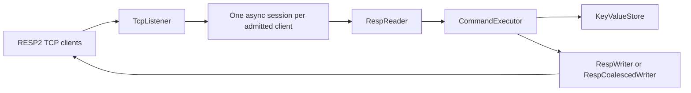

# Architecture

MEMRUNE v0.1 is a small RESP2 TCP service. The executable starts `MemruneServer`; there is no HTTP layer or Redis server library.

## Request path

`MemruneServer` binds to `127.0.0.1:6380` unless `--bind` or `--port` is supplied. It accepts up to 512 active clients by default. An admitted client gets its own `TcpClient`, `NetworkStream`, 4 KiB reader buffer, and sequential command loop. The loop reads one complete RESP2 array, executes it, writes its reply, and continues. Buffered bytes after a command remain in the reader, so pipelined requests keep their response order. Different clients run concurrently.

`RespReader` accepts arrays of bulk strings only. It reads length lines and exact byte counts across arbitrary TCP read boundaries. Limits are 1,024 arguments, 1 MiB per bulk argument, and 4 MiB per complete command frame, including RESP headers and CRLF bytes. Invalid framing produces a RESP error, then closes that connection; the stream cannot safely be resynchronized. A clean EOF between commands closes quietly. Command syntax errors return RESP errors without closing the connection.

`CommandExecutor` validates command names and arguments, then calls `KeyValueStore`. The supported subset is PING, ECHO, QUIT, SET, GET, DEL, EXISTS, EXPIRE, TTL, and SET with EX or PX. Unknown commands return an error. Bulk payloads remain bytes throughout parsing, storage, and writing.

## Storage and expiration

`KeyValueStore` uses `Dictionary<byte[], Entry>` with content-based byte equality and one lock. Each operation, including multi-key DEL and EXISTS, holds that lock for its synchronous work. This makes individual commands atomic and keeps expiration checks with their mutations. It also serializes unrelated keys; no evidence yet justifies a more complex strategy. The lock is never held during TCP I/O. The store copies incoming keys and values. GET selects a live value under the lock, then returns a defensive copy made after releasing the lock, so callers cannot mutate stored bytes.

Expiration is lazy. Entries have UTC deadlines from an injectable `TimeProvider`. At or after the deadline, an access treats the key as absent and removes the entry. Untouched expired entries may remain physically allocated. Plain SET clears an earlier deadline; EX and PX set new deadlines. There is no cleanup worker or global storage memory cap.

## Responses and lifecycle

The default transport enables TCP_NODELAY on accepted sockets and uses a per-connection `RespCoalescedWriter`, which submits one complete, binary-safe RESP frame per response. The original `RespWriter` may use several writes for one response. The switches `--no-tcp-nodelay` and `--no-coalesce-responses` restore the original settings independently; the enabling flags remain available. The [Milestone 7 report](../benchmarks/results/m7/report.md) explains the default decision and its saturated-tail tradeoff.

The listener tracks active sessions. Cancellation stops accepting, closes active sockets, and awaits their tasks. The executable maps Ctrl+C and, on Linux, SIGTERM to that cancellation path. Expected disconnects remain local to one connection; unexpected connection failures are logged without values. The [Docker shutdown check](../tests/check-docker-shutdown.ps1) verifies the SIGTERM path.

## Scope and trust boundary

The server has no authentication, TLS, persistence, idle timeout, total storage cap, or background expiration cleanup. A connected slow client can hold a client slot, and bounded request frames do not bound the total keyspace. Run on loopback or inside the private benchmark network; do not expose it to an untrusted network. RESP3, inline commands, additional Redis commands, and production operations are outside v0.1.
